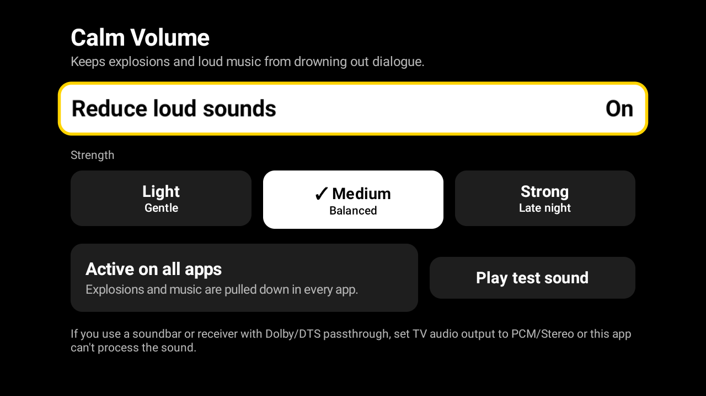

# Calm Volume

An Android TV app that works like Apple TV's "Reduce Loud Sounds". It puts a compressor and a limiter on the TV's audio output, so explosions and loud music get quieter while dialogue stays audible, in any app. No internet permission, no analytics, no ads.



Three strengths: **Light** (gentle), **Medium** (balanced), **Strong** (late night). The values are in [`Preset.kt`](app/src/main/java/com/calmvolume/app/Preset.kt); the design is in [`PLAN.md`](PLAN.md).

## Install

Pick one. You need an Android TV on Android 9 or newer (API 28+).

### 1. Let an AI agent do it

Open a coding agent that can run shell commands (Claude Code, Codex, Gemini CLI) on a computer on the same Wi-Fi as the TV, and paste:

```text
Install Calm Volume on my Android TV. Follow the instructions at
https://github.com/shuvrasankha/calm-volume/blob/main/PROMPT.md
```

The agent downloads the APK from the latest release, finds the TV, installs it, opens it and checks the status. You only have to turn on debugging on the TV and tap "Allow" on the prompt. The full runbook the agent follows is [`PROMPT.md`](PROMPT.md).

### 2. Do it yourself with adb

1. On the TV: Settings → Device Preferences → About → press OK on **Build** seven times. Go back to Developer options and turn on **USB debugging** (and **Network/Wireless debugging** if there is one).
2. On your computer (same Wi-Fi), with [adb](https://developer.android.com/tools/releases/platform-tools) installed, download the APK and install it:

```bash
curl -L -o calm-volume.apk https://github.com/shuvrasankha/calm-volume/releases/latest/download/calm-volume.apk
```

```bash
adb connect <tv-ip>:5555
```

```bash
adb install -r calm-volume.apk
```

Accept "Allow USB debugging?" on the TV the first time. Find the IP under Settings → Network, or run `adb mdns services`.

### 3. USB stick

Download `calm-volume.apk` from the [latest release](https://github.com/shuvrasankha/calm-volume/releases/latest), copy it to a USB stick, plug it into the TV and open it with a file manager app (allow "install unknown apps" for that file manager).

### Build it yourself

Needs JDK 17+ and the Android SDK (compileSdk 37).

```bash
./gradlew assembleDebug
```

The APK is `app/build/outputs/apk/debug/app-debug.apk`. Checks: `./gradlew lint testDebugUnitTest`.

## Use it

Open **Calm Volume** from the launcher, turn **Reduce loud sounds** on and pick a strength. The service keeps running after you leave the app and comes back after a reboot if it was on. The status panel tells you what is happening:

- **Active on all apps**: the effect is on the TV's whole audio output.
- **Active on supported apps only (fallback)**: the TV blocks system-wide effects; only apps that share their audio session are covered.
- **Blocked on this TV**: the TV allows no audio effects at all.

## Check that it's working

1. Turn the effect on and press **Play test sound**: quiet speech, then a loud explosion, then more speech.
2. Stop it, switch the effect **Off**, play again. The explosion should be clearly louder with it off. Try the three strengths.
3. Play a loud movie scene in a real app with the effect on, then off, and compare.

## Known limitations

- **Session 0 may be blocked.** The app first tries the global output mix (audio session 0). That API is deprecated and many TVs refuse it. Tested so far on one TV (AI PONT, Android 11), where it works, using the frequency-resolution mode only. Other TVs may differ.
- **The fallback is narrow.** It only processes players that announce their audio session by broadcast. Many big apps (Netflix, YouTube, Prime Video) do not, so on a TV that blocks session 0 the app may do little or nothing.
- **Passthrough audio can't be processed.** With a soundbar or receiver using Dolby/DTS passthrough, the sound never goes through Android's mixer. Set the TV's audio output to **PCM / Stereo**.
- **Apps with their own audio pipelines** (offload or tunneled playback) can bypass the effect.
- **Notifications:** `POST_NOTIFICATIONS` is declared but not requested. The service runs without it; the status notification is just hidden.
- The release APK is a debug build, signed with the debug key. Fine for sideloading, not for the Play Store.

## Turn debugging off afterwards

Network debugging is plain-text on port 5555. When you are done, switch **USB debugging** and **Network debugging** off in the TV's Developer options. The app keeps working without it.

## Uninstall

```bash
adb uninstall com.calmvolume.app
```
